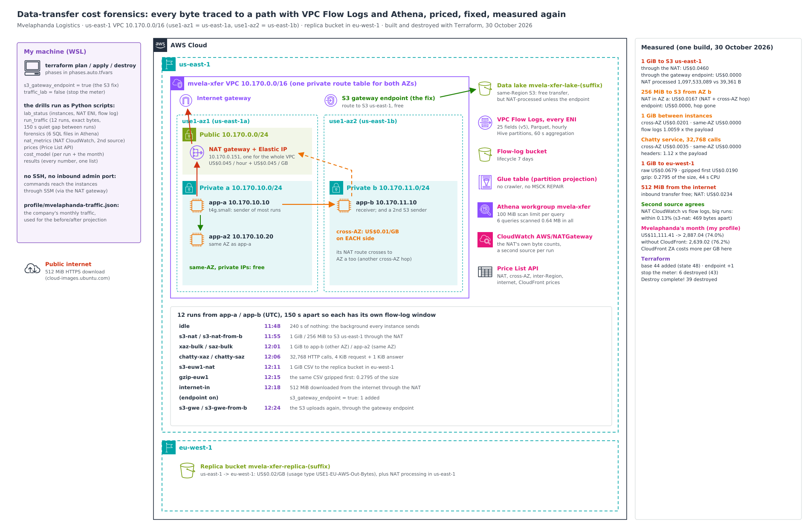

# Data-transfer cost forensics: every byte traced to a path, priced, fixed and measured again

A logistics company's AWS bill had a data-transfer line bigger than its EC2 compute, and nobody could say where the bytes went. I rebuilt a small copy of its network and sent traffic with **exact byte counts** over every path that costs money:
- to S3 through a NAT gateway;
- across Availability Zones;
- to another Region;
- in from the internet.

Then I traced every byte to its path with **VPC Flow Logs and Athena**, checked the result against the **NAT gateway's own CloudWatch metrics**, priced it from the **AWS Price List API**, applied the fixes and measured again.

Everything is declared in **Terraform** and was built, measured and destroyed in one afternoon.



## The scenario: Mvelaphanda Logistics

Mvelaphanda Logistics (a fictional South African logistics company) runs about 120 instances in two AZs behind **one NAT gateway**, the classic setup: every private subnet sends anything outside the VPC through it. Its services call each other across AZs, its data lake is in S3 in the same Region, it replicates data to eu-west-1, and it serves customers over the internet.

The data-transfer charges were larger than the EC2 compute bill, and the cost tools only showed totals per usage type.

**What I set out to answer, with measurements:**
- Which path does each byte take, and what does each path cost per GB?
- How much of the bill is the NAT gateway processing traffic that never needed it, such as same-Region S3?
- What do cross-AZ service calls and a NAT gateway in the "wrong" AZ really add?
- Which fixes work, measured on the same traffic, and what would they save on Mvelaphanda's month?

## Results

All numbers come from one build on 30 October 2026:
- [`docs/results/summary.txt`](docs/results/summary.txt), with every raw file in [`docs/results/`](docs/results/);
- 24 screenshots ([index](docs/screenshots.md)).

Times are UTC. Prices are us-east-1 list prices from the Price List API on the day. For prices and costs, "GB" means 2^30 bytes, as AWS bills it; byte counts are exact, and when I round them in the text (MB, KB) I use decimal units.

| Run (one at a time, 150 s apart) | Sent | Flow logs measured | NAT processed | Cost |
|---|---|---|---|---|
| **1 GiB to S3 us-east-1, through the NAT** | 1,073,741,824 | 1,092,453,029 | 1,097,533,089 | **US$0.0460** |
| **The same, through the S3 gateway endpoint** | 1,073,741,824 | 1,093,553,357 | 39,361 (background) | **US$0.0000** |
| 256 MiB to S3 from AZ b, NAT in AZ a | 268,435,456 | 276,321,282 | 275,172,289 | US$0.0167 (NAT + **cross-AZ hop**) |
| The same, through the gateway endpoint | 268,435,456 | 274,401,680 | 26,306 | US$0.0000 |
| 1 GiB instance to instance, **other AZ** | 1,073,741,824 | 1,080,125,900 | | **US$0.0201** (US$0.01/GB on each side) |
| 1 GiB instance to instance, **same AZ** | 1,073,741,824 | 1,080,080,323 | | **US$0.0000** |
| Chatty service, 32,768 calls, **other AZ** | 167,772,160 | 187,682,432 | | US$0.0035 |
| The same calls, **same AZ** | 167,772,160 | 187,665,792 | | US$0.0000 |
| **1 GiB CSV to eu-west-1** (through the NAT) | 1,073,741,824 | 1,117,620,072 | 1,120,817,728 | **US$0.0679** |
| **The same CSV gzipped first** (0.2795 of the size) | 300,144,888 | 312,264,641 | 314,018,431 | **US$0.0190** |
| 512 MiB downloaded from the internet | 536,870,912 | 556,956,868 | 558,929,849 | US$0.0236 (inbound transfer is free; the NAT isn't) |

| What else | Result |
|---|---|
| **Second source** ([details](docs/nat-cross-check.md)) | For every run that moved real data through the NAT, its CloudWatch `BytesInFromSource + BytesInFromDestination` agree with the flow logs **within 0.13%**. For `s3-nat` they were 469 bytes apart out of 1,097,533,089. |
| **Where each IP lives** | The forensics learned every private IP's AZ from the flow logs themselves. It matched Terraform for all four (three instances and the NAT gateway). |
| **Background** | 240 s of doing nothing: 398 KB to 662 KB an hour per instance, all of it to AWS service addresses through the NAT gateway. |
| **Athena** | Six queries scanned 639,774 bytes in all (the 5 analysis queries 615,320, the delivery check 24,454), against a 100 MiB per-query limit on the workgroup. |
| **Mvelaphanda's month** ([projection](docs/projection.md)) | **US$11,111.41 → US$2,887.04** a month (74.0%), from a traffic profile I wrote for the company. Without CloudFront it's **US$2,639.02** (76.2%), because CloudFront to South African viewers costs more per GB than sending straight from us-east-1. |
| **Terraform** ([details](docs/terraform.md)) | Base `44 added` (state 48) · S3 gateway endpoint `1 added` · "stop the meter" `6 destroyed` (43) · **`Destroy complete! Resources: 39 destroyed.`** Clean check empty in both Regions. |

## How it works

- **The network is the classic one on purpose.** One VPC, a private subnet in each of two AZs, one public subnet, **one NAT gateway in AZ a**, and one private route table for both AZs. AZ b's internet- and S3-bound traffic therefore crosses to AZ a before it leaves.
- **Three t4g.small instances** in private subnets: `app-a` and `app-a2` in AZ a, `app-b` in AZ b. Commands reach them through SSM; there are no SSH keys and no admin ports.
- **A traffic tool** ([`app/mvela_traffic.py`](app/mvela_traffic.py), Python standard library only) runs on the instances. It sends exact byte counts:
  - a TCP sender and receiver;
  - a chatty HTTP service (4 KiB request, 1 KiB answer);
  - S3 uploads (the AWS CLI);
  - a ranged HTTPS download;
  - gzip;
  - an idle baseline.
- **Each run is logged** with its start and end times, and the scripts leave 150 s between runs, so every run has its own window in the flow logs.
- **VPC Flow Logs on every ENI,** including the NAT gateway's.
  - **Format:** 25 version-5 fields, Parquet, Hive-compatible hourly partitions, 60 s aggregation.
  - **Which fields matter:** `flow-direction`, `traffic-path`, `az-id` and `pkt-dst-aws-service` are what make the forensics possible.
  - **How Athena reads them:** a Glue table with partition projection, so there's no crawler.
- **Six SQL files** ([`sql/`](sql/)) classify every record by path. The run windows and addresses are filled in from Terraform's outputs, and the exact SQL that ran is in [`docs/results/sql/`](docs/results/sql/).
  - **AZ of each IP:** learned from the flow logs on both ends.
  - **Hop counting:** each cross-AZ hop is counted once. That includes the hop from `app-b` to the NAT gateway, which is only visible on the NAT gateway's own interface.
  - **NAT traffic:** split into the same four directions CloudWatch reports.
- **The scripts in [`scripts/`](scripts/):**

  | Script | What it does |
  |---|---|
  | `lab_status.py` | Instances (AZ, service, code hash), the NAT gateway's ENI and IP, the flow log's status and fields |
  | `run_traffic.py` | Runs the traffic and logs each run |
  | `forensics.py` | Runs the SQL in Athena: paths, cross-AZ hops, NAT legs, reconciliation, background |
  | `nat_metrics.py` | The NAT gateway's CloudWatch metrics per run, next to the flow logs |
  | `prices.py` | Every price from the Price List API, each lookup required to match exactly one product |
  | `cost_model.py` | The cost of each run, and Mvelaphanda's month before and after the fixes |
  | `ce_usage.py` | The next day: Cost Explorer's billed GB next to the measured GB |
  | `results.py`, `pack_results.py` | One summary of every number; the results packed with the account ID masked |

More detail:
- [the forensics method](docs/forensics.md)
- [paths and costs](docs/paths-and-costs.md)
- [NAT gateway cross-check](docs/nat-cross-check.md)
- [Mvelaphanda's month](docs/projection.md)
- [Terraform](docs/terraform.md)
- [debugging journey](docs/debugging-journey.md)
- [teardown](docs/teardown.md)
- [decisions (ADRs)](docs/adr/)

## Why Terraform

I used to build environments like this with long chains of AWS CLI commands. A NAT gateway alone needs an Elastic IP, the gateway, waiting for it, and a route. Then come flow logs, a Glue table and an Athena workgroup, each needing an ID from the step before. Tearing it down meant the same chain in reverse, in the right order, in two Regions. That was slow and repetitive, and a forgotten NAT gateway bills by the hour.

Here the whole estate is one plan, and the two drills are one variable each:
- `s3_gateway_endpoint = true` adds the S3 fix;
- `traffic_lab = false` "stops the meter": it removes the instances, the NAT gateway and its Elastic IP the moment the traffic is done, and keeps the flow-log data and Athena for the analysis.

The instances `depends_on` the NAT route, the egress rule and their IAM policies, so on the way down they go first, while everything they need to shut down cleanly still exists.

## What went wrong, and what I changed

The full story is in [docs/debugging-journey.md](docs/debugging-journey.md).

- **Two inter-Region prices didn't resolve.**
  - My lookup used `USE1-EUW1-AWS-Out-Bytes`, and no product matched. eu-west-1's billing code is the old **`EU`**, not `EUW1`, so the usage type is `USE1-EU-AWS-Out-Bytes`.
  - The cost model refused to run with a missing price, which is what it should do.
  - I reran the lookup with the right usage types as a one-off override, and each matched exactly one product (US$0.02/GB both ways). The names are now fixed in `prices.py` and `ce_usage.py`.
- **A status script stopped the build with "terraform output is missing s3_gateway_endpoint_id".** `terraform output -json` leaves out any output whose value is null, and the endpoint output is null until its phase is on. The script now treats an absent optional output as "off".
- **Both chatty runs reported exactly 8.021 s.** The bytes were exact, but the duration came from a monitoring loop that checks every 0.5 s, so it could only land on 0.5 s steps. Both runs finished somewhere between 7.5 and 8.0 s. The tool now records when the last worker finishes. The byte counts, and therefore every cost, were never affected.

## Compliance and frameworks

| Framework | What applies | What I built | Gap I'd close in production |
|---|---|---|---|
| **NIST SP 800-53 Rev. 5** | AU-2/AU-12 event logging, SI-4 system monitoring, SC-7 boundary protection, CM-3 change control | Flow logs on every ENI in the VPC, queryable with Athena; private instances with no inbound admin ports; every change through a reviewed Terraform plan | Longer flow-log retention; alerts on unexpected paths, e.g. new NAT traffic to S3 |
| **ISO/IEC 27001:2022** | A.8.15 logging, A.8.16 monitoring activities, A.8.20 network security | Network flows recorded and analysable per run; the network path of each service is known and documented | A standing monthly data-transfer review |
| **POPIA** (South Africa), sections 19 and 72 | Section 72: every copy of personal information outside South Africa is a cross-border transfer, the primary data in us-east-1 as well as the eu-west-1 replica. Section 19: security safeguards | The drill shows exactly which bytes go to which Region and what they cost; private instances, TLS-only buckets, Block Public Access | A documented legal basis for each cross-border copy (section 72); SSE-KMS with customer managed keys, which checkov flagged (section 19) |

The FinOps Framework's "understand usage and cost" and "allocation" capabilities are the reason for the per-path view, but the framework isn't a compliance standard.

## Repo layout

```
app/              mvela_traffic.py: the traffic tool on the instances (stdlib only)
bootstrap/        the shared Terraform state bucket (one-time)
infra/            network (VPC, NAT, endpoint), compute, storage (lake + replica), forensics (flow logs, Glue, Athena)
profile/          mvelaphanda-traffic.json: the company's monthly traffic for the projection
scripts/          lab_status, run_traffic, forensics, nat_metrics, prices, cost_model, ce_usage, results, pack_results
sql/              the six Athena queries (templates; the filled-in copies are in docs/results/sql/)
docs/             architecture, write-ups, ADRs, results (as measured), screenshots
```

## Reproduce it

From the repo folder, with AWS CLI v2, Terraform 1.11 or newer, Python 3, and an existing state bucket:

```bash
cp env.sh.example env.sh && mkdir -p build/results && source ./env.sh
python3 -c 'import secrets; print("name_suffix = \"%s\"" % secrets.token_hex(4))' > infra/name.auto.tfvars
terraform -chdir=infra init -backend-config="bucket=<your state bucket>"
terraform -chdir=infra apply                                     # 44 resources
python3 scripts/lab_status.py && python3 scripts/run_traffic.py prepare
python3 scripts/run_traffic.py run idle s3-nat s3-nat-from-b xaz-bulk saz-bulk chatty-xaz chatty-saz s3-euw1-nat gzip-euw1 internet-in
echo 's3_gateway_endpoint = true' >> infra/phases.auto.tfvars && terraform -chdir=infra apply
python3 scripts/run_traffic.py run s3-gwe s3-gwe-from-b
echo 'traffic_lab = false' >> infra/phases.auto.tfvars && terraform -chdir=infra apply   # stop the meter
python3 scripts/forensics.py check && python3 scripts/forensics.py all && python3 scripts/nat_metrics.py
python3 scripts/prices.py && python3 scripts/cost_model.py && python3 scripts/results.py
terraform -chdir=infra destroy
```

Wait for the flow logs to arrive before the forensics: delivery to S3 takes about 10 minutes. The sitting costs well under a dollar, and the NAT gateway is most of it, so stop the meter as soon as the traffic is done. Always destroy afterwards ([teardown and clean check](docs/teardown.md)).

## What I'd tell the next team

- **Put an S3 gateway endpoint in every VPC that talks to S3.** It's free, and without it every byte to S3 in the same Region pays NAT processing: US$0.045/GB here, on transfer that is otherwise free.
- **One NAT gateway for two AZs saves an hourly charge and costs a cross-AZ hop on every byte from the other AZ.** At volume, a NAT gateway per AZ is cheaper.
- **Keep chatty services in their own AZ.** The same 32,768 calls cost US$0.0035 across AZs and nothing within one, and they carried 12% more bytes than their payloads.
- **Compress before crossing a Region boundary.** Text compressed to 28% here. It took 44 s on a t4g.small for 1 GiB (elapsed), and it cut that copy's cost by 72%.
- **CloudFront isn't automatically cheaper.** To South African viewers its per-GB price is higher than sending straight from us-east-1. Its case is caching and latency, not price.
- **The flow logs can account for the bill to the byte,** if each run has its own window and the analysis learns the network from the logs themselves.
